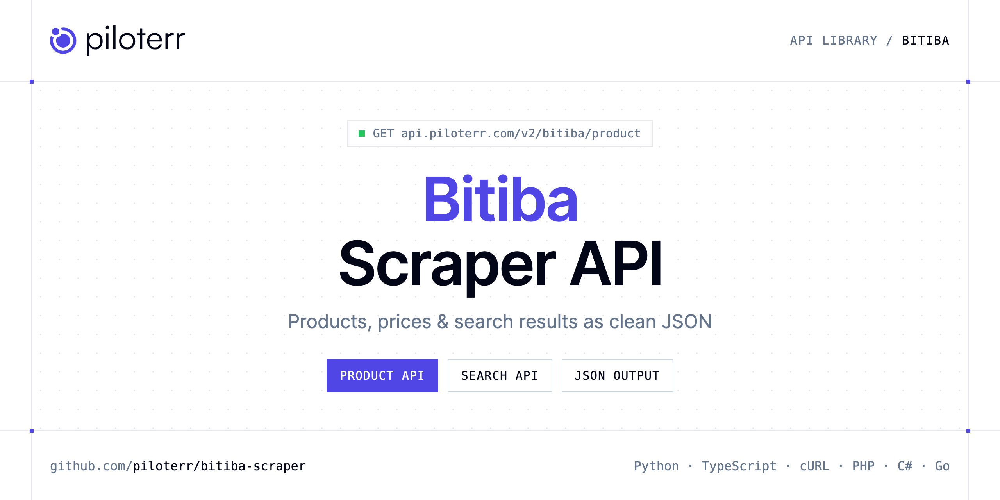

<p align="center">
  <a href="https://www.piloterr.com"></a>
</p>

# Bitiba Scraper API

[](https://discord.gg/CFj3ph8aHU) [](https://app.piloterr.com) [](https://app.piloterr.com/openapi) [](LICENSE)

The **Piloterr Bitiba Scraper API** lets you extract public data from Bitiba as **clean, structured JSON** — no proxies, headless browsers or HTML parsing to maintain. Endpoints available in production:

- **Bitiba Product API** — Read one product from a live Bitiba shop, including the selected variant price and the pack list.
- **Bitiba Search API** — Search a live Bitiba country shop.

Use it for price monitoring, assortment tracking, competitor analysis, product research or catalog enrichment.

| Endpoint | Path | Credits | What you get |
|---|---|---|---|
| [Bitiba Product API](#bitiba-product-api) | `/v2/bitiba/product` | 1 | Read one product from a live Bitiba shop, including the selected variant price and the pack list. |
| [Bitiba Search API](#bitiba-search-api) | `/v2/bitiba/search` | 1 | Search a live Bitiba country shop. Germany is the default. www.bitiba.com is closed and returns 400. |

## Table of contents

- [How it works](#how-it-works)
- [Bitiba Product API](#bitiba-product-api)
- [Bitiba Search API](#bitiba-search-api)
- [Code examples in other languages](#code-examples-in-other-languages)
- [Practical use cases](#practical-use-cases)
- [Why Piloterr?](#why-piloterr)
- [FAQ](#faq)
- [Related scrapers](#related-scrapers)
- [Support](#support)

## How it works

1. **Create a free Piloterr account** and copy your API key from the [dashboard](https://app.piloterr.com).
2. **Send a `GET` (or `POST`) request** to `https://api.piloterr.com/v2/...` with the header `x-api-key: YOUR_API_KEY`.
3. **Receive structured JSON** — Piloterr handles rendering, proxies, retries and parsing.

```bash
export PILOTERR_API_KEY="your-api-key"
pip install requests        # Python
# TypeScript: Node.js 18+ (native fetch), run with `npx tsx file.ts`
```

> Every endpoint accepts both `GET` (query string) and `POST` (JSON body with the same fields).

## Bitiba Product API

Read one product from a live Bitiba shop, including the selected variant price and the pack list.

`GET | POST https://api.piloterr.com/v2/bitiba/product` · **1 credit per request** · [Full reference](https://app.piloterr.com/openapi)

### Request parameters

| Parameter | Type | Required | Description |
|---|---|---|---|
| `query` | string | ✅ | Product URL, shop path, or product number. Example: 75036. A search link returns 400. |
| `region` | string | — | Shop used when query is a number or a path. de is Germany (default). |
| `return_page_source` | boolean | — | Set to true to get the raw HTML in result. |

### Python example

```python
import json
import os
import requests

response = requests.get(
    "https://api.piloterr.com/v2/bitiba/product",
    headers={"x-api-key": os.environ["PILOTERR_API_KEY"]},
    params={
        "query": "75036. A search link returns 400.",
    },
    timeout=60,
)
response.raise_for_status()
data = response.json()

print(json.dumps(data, indent=2, ensure_ascii=False)[:2000])
```

### TypeScript example

```typescript
type BitibaProduct = {
  ean?: string;
  url?: string;
  unit?: string;
  brand?: string;
  price?: number;
  title?: string;
  brands?: string[];
  images?: string[];
  rating?: number;
  region?: string;
  reviews?: {
    body?: string;
    date?: string;
    title?: string;
    votes?: number;
    author?: string;
    rating?: number;
    variant?: string;
    review_id?: number;
    verified_purchase?: boolean;
  }[];
  summary?: string;
  category?: string;
  currency?: string;
  in_stock?: boolean;
  variants?: {
    ean?: string;
    sku?: string;
    unit?: string;
    price?: number;
    badges?: string[];
    seller?: string;
    currency?: string;
    available?: boolean;
    discounts?: {
      type?: string;
      label?: string;
      price?: number;
      price_display?: string;
    }[];
    image_url?: string;
    article_id?: string;
    attributes?: {
      name?: string;
      value?: string;
    }[];
    supplement?: boolean;
    unit_price?: number;
    variant_id?: string;
    description?: string;
    constituents?: {
      name?: string;
      unit?: string;
      amount?: number;
    }[];
    price_display?: string;
    delivery_max_days?: number;
    delivery_min_days?: number;
    unit_price_display?: string;
  }[];
  image_url?: string;
  is_choice?: boolean;
  price_max?: number;
  price_min?: number;
  product_id?: string;
  unit_price?: number;
  breadcrumbs?: {
    url?: string;
    title?: string;
  }[];
  description?: string;
  ingredients?: string;
  [key: string]: unknown;
};

const params = new URLSearchParams({
  "query": "75036. A search link returns 400.",
});

const response = await fetch(`https://api.piloterr.com/v2/bitiba/product?${params}`, {
  headers: { "x-api-key": process.env.PILOTERR_API_KEY! },
});
if (!response.ok) throw new Error(`Piloterr error ${response.status}: ${await response.text()}`);

const data = (await response.json()) as BitibaProduct;

console.log(JSON.stringify(data, null, 2).slice(0, 2000));
```

<details>
<summary><b>POST variant</b></summary>

```http
POST https://api.piloterr.com/v2/bitiba/product
x-api-key: YOUR_API_KEY
Content-Type: application/json

{"query": "75036. A search link returns 400."}
```
</details>

### Output example

Example response from the API reference, abridged — real values depend on the page you scrape.

```json
{
  "ean": "4015598322201",
  "url": "https://www.bitiba.de/shop/hunde/hundefutter_trocken/my_friend/75036",
  "unit": "kg",
  "brand": "Bosch My Friend",
  "price": 23.49,
  "title": "My Friend Hundefutter",
  "brands": [
    "Bosch My Friend"
  ],
  "images": [
    "https://media.zooplus.com/bilder/8/800/13912_pla_my_friend_hundefutter_8.jpg"
  ],
  "rating": 5,
  "region": "de",
  "reviews": [
    {
      "body": "Meine Old english Bulldogge bekommt hauptsächlich Fleisch vom Metzger und zwar Lamm und Rind, sowie diese Knochen. Dazu bekommt sie Nassf…",
      "date": "2026-06-25",
      "title": "Zufriedener Hund",
      "votes": 0,
      "author": "example",
      "rating": 4,
      "variant": "20 kg",
      "review_id": 15538425,
      "verified_purchase": false
    },
    {
      "body": "Das Futter ist Prima würde ich immer wieder empfehlen",
      "date": "2025-12-05",
      "title": "Super Produkt",
      "votes": 0,
      "author": "example",
      "rating": 5,
      "variant": null,
      "review_id": 15152485,
      "verified_purchase": false
    }
  ],
  "summary": "Ausgewogene Vollnahrung für ausgewachsene Hunde mit normaler Aktivität, bekömmlich und sehr schmackhaft, moderater Energiegehalt, ohne kü…",
  "category": "Hundefutter und Zubehör > Hundefutter Trockennahrung > My Friend",
  "currency": "EUR",
  "in_stock": true,
  "variants": [
    {
      "ean": "4015598322201",
      "sku": "75036.2",
      "unit": "kg",
      "price": 23.49,
      "badges": [
        "autoshipment"
      ],
      "seller": "example",
      "currency": "EUR",
      "available": true,
      "discounts": [
        {}
      ],
      "image_url": "https://media.zooplus.com/bilder/8/800/13912_pla_my_friend_hundefutter_8.jpg",
      "article_id": "343803",
      "attributes": [
        {},
        {}
      ],
      "supplement": false,
      "unit_price": 1.17,
      "variant_id": "2",
      "description": "20 kg",
      "constituents": [
        {},
        {}
      ],
      "price_display": "23,49 €",
      "delivery_max_days": 4,
      "delivery_min_days": 2,
      "unit_price_display": "1,17 € / kg"
    }
  ],
  "image_url": "https://media.zooplus.com/bilder/8/800/13912_pla_my_friend_hundefutter_8.jpg",
  "is_choice": false,
  "price_max": 23.49,
  "price_min": 23.49,
  "product_id": "75036",
  "unit_price": 1.17,
  "breadcrumbs": [
    {
      "url": "https://www.bitiba.de/",
      "title": "bitiba.de"
    },
    {
      "url": "https://www.bitiba.de/shop/hunde",
      "title": "Hundefutter und Zubehör"
    }
  ],
  "description": "My Friend Hundefutter ist ein Alleinfuttermittel für ausgewachsene Hunde aller Rassen. Ausschließlich erlesene, hochwertige Zutaten werde…",
  "ingredients": "Zusammensetzung\nGetreide, Fleisch und tierische Nebenerzeugnisse, pflanzliche Nebenerzeugnisse, Öle und Fette, Mineralstoffe.\nZusatzstoff…"
}
```

### Response fields

| Field | Type | Description |
|---|---|---|
| `ean` | string |  |
| `url` | string |  |
| `unit` | string |  |
| `brand` | string |  |
| `price` | number |  |
| `title` | string |  |
| `brands` | string[] |  |
| `images` | string[] |  |
| `rating` | integer |  |
| `region` | string |  |
| `reviews[]` | object[] |  |
| `reviews[].body` | string |  |
| `reviews[].date` | string |  |
| `reviews[].title` | string |  |
| `reviews[].votes` | integer |  |
| `reviews[].author` | string |  |
| `reviews[].rating` | integer |  |
| `reviews[].variant` | string |  |
| `reviews[].review_id` | integer |  |
| `reviews[].verified_purchase` | boolean |  |
| `summary` | string |  |
| `category` | string |  |
| `currency` | string |  |
| `in_stock` | boolean |  |
| `variants[]` | object[] |  |

## Bitiba Search API

Search a live Bitiba country shop. Germany is the default. www.bitiba.com is closed and returns 400.

`GET | POST https://api.piloterr.com/v2/bitiba/search` · **1 credit per request** · [Full reference](https://app.piloterr.com/openapi)

### Request parameters

| Parameter | Type | Required | Description |
|---|---|---|---|
| `query` | string | ✅ | What to look for. A word such as hundefutter, or a Bitiba search link. A product link returns 400. www.bitiba.com returns 400. |
| `region` | string | — | Country shop. de is Germany (default), fr is France, uk is the United Kingdom. gb means uk. |
| `page` | number | — | Page number, starting at 1. Page 2 uses p=2. |
| `return_page_source` | boolean | — | Set to true to get the raw HTML in result. |

### Python example

```python
import json
import os
import requests

response = requests.get(
    "https://api.piloterr.com/v2/bitiba/search",
    headers={"x-api-key": os.environ["PILOTERR_API_KEY"]},
    params={
        "query": "hundefutter",
    },
    timeout=60,
)
response.raise_for_status()
data = response.json()

print(json.dumps(data, indent=2, ensure_ascii=False)[:2000])
```

### TypeScript example

```typescript
type BitibaSearch = {
  results?: {
    sku?: string;
    url?: string;
    unit?: string;
    brand?: string;
    price?: number;
    title?: string;
    brands?: string[];
    images?: string[];
    is_new?: boolean;
    rating?: number;
    region?: string;
    summary?: string;
    currency?: string;
    in_stock?: boolean;
    image_alt?: string;
    image_url?: string;
    is_choice?: boolean;
    pet_types?: string[];
    article_id?: string;
    is_reduced?: boolean;
    product_id?: string;
    unit_price?: number;
    variant_id?: string;
    choice_label?: unknown;
    is_sponsored?: boolean;
    [key: string]: unknown;
  }[];
  pagination?: {
    next?: string;
    page?: number;
    per_page?: number;
    total_pages?: number;
    total_results?: number;
  };
};

const params = new URLSearchParams({
  "query": "hundefutter",
});

const response = await fetch(`https://api.piloterr.com/v2/bitiba/search?${params}`, {
  headers: { "x-api-key": process.env.PILOTERR_API_KEY! },
});
if (!response.ok) throw new Error(`Piloterr error ${response.status}: ${await response.text()}`);

const data = (await response.json()) as BitibaSearch;

console.log(JSON.stringify(data, null, 2).slice(0, 2000));
```

<details>
<summary><b>POST variant</b></summary>

```http
POST https://api.piloterr.com/v2/bitiba/search
x-api-key: YOUR_API_KEY
Content-Type: application/json

{"query": "hundefutter"}
```
</details>

### Output example

Example response from the API reference, abridged — real values depend on the page you scrape.

```json
{
  "results": [
    {
      "sku": "75036.2",
      "url": "https://www.bitiba.de/shop/hunde/hundefutter_trocken/my_friend/75036?activeVariant=75036.2",
      "unit": "kg",
      "brand": "Bosch My Friend",
      "price": 23.49,
      "title": "My Friend Hundefutter",
      "brands": [
        "Bosch My Friend"
      ],
      "images": [
        "https://media.zooplus.com/bilder/8/400/13912_pla_my_friend_hundefutter_8.jpg"
      ],
      "is_new": false,
      "rating": 4.6,
      "region": "de",
      "summary": "Ausgewogene Vollnahrung für ausgewachsene Hunde mit normaler Aktivität, bekömmlich und sehr schmackhaft, moderater Energiegehalt, ohne kü…",
      "currency": "EUR",
      "in_stock": true,
      "image_alt": "My Friend Hundefutter - 20 kg",
      "image_url": "https://media.zooplus.com/bilder/8/400/13912_pla_my_friend_hundefutter_8.jpg",
      "is_choice": false,
      "pet_types": [
        "DOGS"
      ],
      "article_id": "343803",
      "is_reduced": true,
      "product_id": "75036",
      "unit_price": 1.17,
      "variant_id": "2",
      "choice_label": null,
      "is_sponsored": false
    }
  ],
  "pagination": {
    "next": "https://www.bitiba.de/search/results?q=hundefutter&p=2",
    "page": 1,
    "per_page": 48,
    "total_pages": 160,
    "total_results": 7652
  }
}
```

### Response fields

| Field | Type | Description |
|---|---|---|
| `results[]` | object[] |  |
| `results[].sku` | string |  |
| `results[].url` | string |  |
| `results[].unit` | string |  |
| `results[].brand` | string |  |
| `results[].price` | number |  |
| `results[].title` | string |  |
| `results[].brands` | string[] |  |
| `results[].images` | string[] |  |
| `results[].is_new` | boolean |  |
| `results[].rating` | number |  |
| `results[].region` | string |  |
| `results[].summary` | string |  |
| `results[].currency` | string |  |
| `results[].in_stock` | boolean |  |
| `results[].image_alt` | string |  |
| `results[].image_url` | string |  |
| `results[].is_choice` | boolean |  |
| `results[].pet_types` | string[] |  |
| `results[].article_id` | string |  |
| `results[].is_reduced` | boolean |  |
| `results[].product_id` | string |  |
| `results[].unit_price` | number |  |
| `results[].variant_id` | string |  |
| `results[].choice_label` | object |  |

## Code examples in other languages

Ready-to-run examples live in the [`examples/`](examples) folder. Each one reads your key from the `PILOTERR_API_KEY` environment variable.

| Language | Product | Search |
|---|---|---|
| cURL (Bash) | [`product`](examples/curl/product.sh) | [`search`](examples/curl/search.sh) |
| PHP | [`product`](examples/php/product.php) | [`search`](examples/php/search.php) |
| C# | [`product`](examples/csharp/Product.cs) | [`search`](examples/csharp/Search.cs) |
| Go | [`product`](examples/go/product.go) | [`search`](examples/go/search.go) |
| Java | [`product`](examples/java/ProductExample.java) | [`search`](examples/java/SearchExample.java) |
| Ruby | [`product`](examples/ruby/product.rb) | [`search`](examples/ruby/search.rb) |
| Node.js | [`product`](examples/nodejs/product.mjs) | [`search`](examples/nodejs/search.mjs) |

## Practical use cases

- **Price monitoring** — Track prices, promotions and availability over time to react to competitors.
- **Assortment & catalog tracking** — Follow new products, delisted items and category changes.
- **Competitor analysis** — Benchmark ranges, brands and positioning across retailers.
- **Product research** — Spot best-sellers and trends from search results.
- **Catalog enrichment** — Pull titles, images and attributes into your PIM or marketplace listings.

## Why Piloterr?

- **No infrastructure** — no proxies, headless browsers or CAPTCHA solving to run yourself.
- **Structured JSON** — stable, documented fields instead of brittle HTML selectors.
- **Pay per request** — transparent credit cost per endpoint, failed requests are retried for you.
- **One API key, hundreds of sources** — Bitiba plus many other e-commerce, search and company data endpoints in the [Piloterr library](https://www.piloterr.com/library).
- **Any language** — plain HTTPS + JSON, with examples for Python, TypeScript, cURL, PHP, C#, Go, Java, Ruby and Node.js.

## FAQ

### Is it legal to scrape Bitiba?

Collecting publicly available data is generally allowed in many jurisdictions, but rules depend on your country, the data you collect and how you use it. Avoid personal data unless you have a lawful basis, respect the website's terms where they apply, and get legal advice for your specific use case. This is not legal advice.

### Do I need proxies or a headless browser?

No. Piloterr handles rendering, proxy rotation and retries on its side. You only send an HTTPS request with your `x-api-key` header and receive JSON.

### How much does a request cost?

Credits per call: `/v2/bitiba/product` **1**, `/v2/bitiba/search` **1**. See the [Piloterr website](https://www.piloterr.com) for plans.

### What data does the Bitiba API return?

Each endpoint returns structured JSON: **Bitiba Product** — `ean`, `url`, `unit`, `brand`, `price`, `title`; **Bitiba Search** — `results[]`, `results[].sku`, `results[].url`, `results[].unit`, `results[].brand`, `results[].price`.

### How do I paginate Bitiba results?

Use the `page` parameter and keep requesting while the response indicates more results.

### Can I target a specific country or language?

Yes, use `region` — see the parameter tables above for accepted values.

### Can I get the raw HTML instead of JSON?

Yes. Set `return_page_source=true` and the response becomes `{"result": "..."}` with the page source.

### Which languages are supported?

Any language that can make an HTTP request. This README shows Python and TypeScript; the [`examples/`](examples) folder contains cURL, PHP, C#, Go, Java, Ruby and Node.js.

## Related scrapers

- [About You Scraper API](https://github.com/piloterr/aboutyou-scraper)
- [Action Scraper API](https://github.com/piloterr/action-scraper)
- [Aldi Scraper API](https://github.com/piloterr/aldi-scraper)
- [Alibaba Scraper API](https://github.com/piloterr/alibaba-scraper)
- [AliExpress Scraper API](https://github.com/piloterr/aliexpress-scraper)
- [Allegro Scraper API](https://github.com/piloterr/allegro-scraper)
- [All Piloterr scrapers on GitHub](https://github.com/piloterr)

## Support

- 💬 Join the [Piloterr Discord](https://discord.gg/CFj3ph8aHU) to ask questions and share what you build.
- 📚 Browse the [API reference (OpenAPI)](https://app.piloterr.com/openapi) and the [Piloterr library](https://www.piloterr.com/library).
- 🔑 [Get your API key](https://app.piloterr.com).

---

<p align="center">
  <a href="https://www.piloterr.com">
    <picture>
      <source media="(prefers-color-scheme: dark)" srcset="images/logo-dark.svg">
      
    </picture>
  </a>
  <br>
  <sub>Built by <a href="https://www.piloterr.com">Piloterr</a> — web scraping APIs for e-commerce, search, real estate and more, one API key.</sub>
</p>

<sub>Bitiba is a trademark of its respective owner. This repository is not affiliated with or endorsed by Bitiba. Examples are released under the MIT license.</sub>
